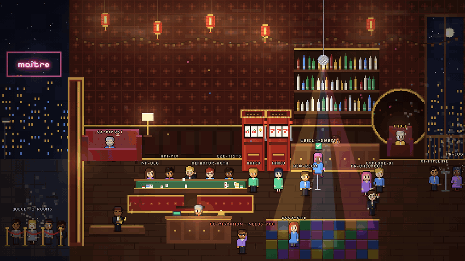
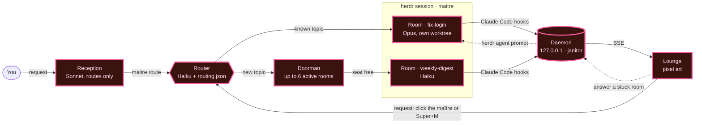

<p align="center">
  
</p>

<h3 align="center">Your agents' lounge.</h3>

<p align="center">
  A terminal orchestrator for Claude Code agents, with a pixel-art lounge where you watch them work.
</p>

<p align="center">
  <a href="LICENSE"></a>
  <a href="package.json"></a>
  
  <a href="#roadmap"></a>
</p>

<p align="center">
  
</p>

> [!NOTE]
> **maître is early.** What runs today is **M3a: run `./setup` once, then press Super+M or click the maître in the lounge, type a request, and watch the room walk in.** Each request goes to a room, a Claude Code session in its own git worktree and herdr tab, on the model the task calls for. A doorman keeps at most 6 rooms active and lines up the rest on the sidewalk, and a janitor closes rooms left idle with nothing pending, writing minutes to a markdown vault. Built, with its end-to-end check on a real Claude Code still pending (M3b): a room on the couch or waiting on its PR gives up its Claude after 30 quiet minutes and wakes with `claude --resume` when you need it again; the lounge follows each room's PR (CI and review notices, a dance on merge), and a new room on an old topic starts with the old room's minutes. `maitre` in a terminal still opens herdr with the reception and the lounge, and the demo mode and rooms opened by hand with `maitre room run` still work. The building (M4) and answering from the lounge (M5) are the design being built next. Sections below mark what is planned, and the [Roadmap](#roadmap) tracks it.

## What is it


This is what maître is being built to do. Today you write requests at the reception, they land in rooms, you watch the rooms in the lounge, and the janitor tidies up after them; the rest arrives milestone by milestone.

Running one coding agent is easy. Running five is a juggling act: which tab had the failing test, which conversation was about the login bug, which worktree is safe to delete.

maître runs the room for you, like the maître d' of a busy lounge.

- **A reception, not a chat log.** You write every request in one place. The reception does no work itself: it sends the request to the room that already handles that topic, or opens a new one.
- **One room per topic, named for you.** Each room is a real, interactive Claude Code session in its own git worktree, named after its topic (`fix-login`, `weekly-digest`). You can walk into any room and talk to it directly.
- **The right model for the job.** A routing table maps each kind of task to a model: Haiku for reading, summarizing and naming; Sonnet for the reception, exploration and clear changes; Opus for development; Fable as the advisor before big decisions. Each room records how it went, so routing learns.
- **A janitor that never loses work.** A room idle for 4 hours with nothing pending (no uncommitted change, no unpushed commit, no open PR, no open question, no `.env` file) closes on its own and leaves minutes in a markdown vault. Anything with loose ends goes to the couch instead, with the reason.
- **A lounge you can leave open all day.** A pixel-art building where every agent's place tells you its state at a glance, and where the one agent that needs you rings the bell.

## Features

What you can run today is marked **today**: it works with real rooms as well as in the demo. Everything else is the design, tagged with the milestone that brings it.

| | Feature | When |
|---|---|---|
|  | **Card table.** A working agent plays cards while it uses its tools. | **today** |
|  | **Slot machines.** A subagent pulls the lever while it works. The lever is yours to pull too, jackpot included. | **today** |
|  | **The musician.** Click him for live, generative **jazz** (walking bass, swung ride, ii-V-I, a synth sax) or **house** (four-on-the-floor, off-beat hats, chord stabs). Made with WebAudio, no recordings. | **today** |
|  | **The bell.** An agent that needs you goes to the reception desk with a red "!" and a sound. Click it to see the reason and the options (in the demo, with the recommended one marked). | **today**; you answer in the room's terminal (the panel's **Open in terminal** button takes you there), and from the lounge in M5 |
|  | **Ready, quietly.** An agent that finished its turn without asking anything waits at the bar with a green check. No sound. | **today** |
|  | **Reception and rooms.** One request box, one room per topic, automatic names, and the project found from an index of your repos. | **today**, in the terminal, by clicking the maître in the lounge, or with the Super+M prompt |
|  | **Model routing** by task type, applied by code, with outcomes that feed back into the router. | **today** by task type; learning in M5 |
|  | **Doorman.** At most 6 active rooms at once (configurable); the rest queue on the sidewalk and walk in, oldest first, when a seat frees. | **today**; a couched room or one waiting on its PR giving up its seat and waking with `--resume` is built, end-to-end check pending (M3b) |
|  | **Janitor.** Closes idle rooms with nothing pending and writes minutes to an Obsidian-compatible vault; rooms with loose ends go to the couch. | **today**; watching PRs too (CI and review notices, the merge dance, a PR closed without merge) is built, end-to-end check pending (M3b) |
|  | **The building.** One themed floor per project, a lobby, a shared smoking terrace and an elevator. | M4 |
|  | **Answer from anywhere.** Reply to a stuck room from the lounge, chat with a room from its panel, or pick an option straight from a desktop notification. | M5 |

## Quick start

### Requirements

- **Node.js 20 or newer.**
- **Linux.** macOS is planned, and nothing in the design blocks it.
- **Google Chrome** (optional): the lounge and the quick prompt open as app windows, with maître's own Chrome profile. Chromium is not used: on Ubuntu it is a snap, which cannot use a profile in maître's hidden folder. Without Google Chrome, the lounge opens as a tab in your default browser and the prompt is a normal tab, not a small window.
- **For real rooms:** [Claude Code](https://docs.anthropic.com/en/docs/claude-code), with `claude` on your `PATH`.
- **For the reception and rooms:** [herdr](https://herdr.dev) (tested with 0.8.2), Claude Code (tested with 2.1), and `git`. Your projects are local clones with an `origin` remote.
- **Claude Code auth:** whatever already works for `claude` works in maître. API keys, gateways (`ANTHROPIC_BASE_URL`), Bedrock, Vertex and `CLAUDE_CONFIG_DIR` pass through to herdr, the reception and the rooms; only the session markers of a Claude Code you launch `maitre` from are dropped. The login service is different: see [The service](#one-step-setup-works-today).

### Run the demo lounge (works today)

```sh
git clone https://github.com/danielrdg/maitre
cd maitre
npm install
npm run build
npm run demo          # same as: node bin/maitre lounge --demo
```

maître starts a small server on `127.0.0.1`, prints the lounge URL with its access token, and opens the window. Press `Ctrl+C` to stop.

```text
maitre                                   open the reception and the lounge in herdr
maitre open                              open the lounge window, starting the lounge if needed
maitre prompt                            open the small prompt window, starting the lounge if needed
maitre serve [--port <n>]                run the live lounge with no window (what the login service runs)
maitre setup [--dry-run] [--uninstall]   install the command, the service, the icon and the shortcut
maitre index [--root <dir>]...           scan your repos for the project index
maitre projects                          list the indexed projects
maitre room list                         rooms, their herdr status and lounge state, queued and failed rooms
maitre room send <room> "<text>"         send a room a message without waiting for its turn
maitre room close <room>                 write a room's minutes, exit it and close its tab (its folder is kept)
maitre room wake <room>                  bring back a parked room (or one whose Claude died) with its session
maitre janitor [--dry-run]               run the janitor once now (--dry-run: only print what it would do)
maitre room open <name> [--project <p>] --model <m> --task <type> (--brief "<text>" | --brief-file <path>)
maitre route <id> [<id>...] [--json]     what the reception runs: classify a request
maitre dispatch <id>                     what the reception runs: open or feed the room
maitre lounge [--demo] [--port <n>] [--no-open] [--lang en|pt-BR]
maitre room run <name> [--brief-file <path>] [-- <claude args>]
maitre status <working|waiting|blocked> "<text>" [--option <o>]...

  --demo        Run the lounge with simulated agents
  --port <n>    Preferred port (default 8737; falls back to the next free one)
  --no-open     Do not open a browser window
  --lang <l>    Interface language: en or pt-BR (default en)
```

Want `maitre` on your `PATH`? Run `npm link` once from the clone.

`npm install` reports dev-only advisories in `extract-zip`, which `puppeteer-core` uses only to download a browser; the asset script uses your system Chrome instead, so that path never runs. Do not run `npm audit fix --force`: it downgrades `puppeteer-core` and breaks `npm run assets`.

In the demo, the **demo** menu in the corner lets you block an agent, merge a PR and send a new room to the queue. Click any agent for its panel, pull a slot lever, and click the musician for music. Sound starts after your first click, as browsers require.

### Your first reception (works today)

Put `maitre` on your `PATH` (`npm link`, above), tell it where your repos live, and open it:

```sh
maitre index --root ~/code     # finds git repos up to two levels down; run it again after adding repos
maitre projects                # what it found: name, base branch, path
maitre                         # opens herdr with the reception and the lounge
```

`maitre` starts a herdr session named `maitre` with two tabs, **reception** and **lounge**, opens the lounge window and attaches you to herdr, on the reception. Detach with herdr's detach key (`Ctrl+B` then `Q` by default): everything keeps running. Run `maitre` again to come back; it reuses the tabs that are alive and creates only what is missing. The lounge window opens only when the lounge itself (re)starts; after closing it, `maitre open` brings it back. When the login service from [`./setup`](#one-step-setup-works-today) is running, `maitre` uses its lounge and does not create a **lounge** tab.

**The first launch.** Claude Code asks whether you trust a folder the first time it starts there. maître answers that dialog on screen only for its own folders: the reception's folder (`$MAITRE_HOME/reception`) and the scratch folders. It never answers for a room worktree, because Claude Code records a worktree's trust under the project's main clone (as of Claude Code 2.1), and that choice is yours. When a new worktree room shows the dialog, the room still opens, `maitre dispatch` and `maitre room open` say "answer the folder-trust question in its tab", and the lounge rings until you answer it there. Once you trust a project, its later rooms start without asking. maître never edits Claude Code's config files itself.

**What the reception does.** You type a request (*fix the login redirect in backend*). A hook saves your words to a file and gives the request a number. The reception then runs `maitre route <id>`, a short Haiku call that sees the project index and the open rooms and picks the project, the room and the kind of task. Then `maitre dispatch <id>` opens a new room or sends the request to the room that already handles the topic. If the request is unclear, the reception asks you one question first. It also answers "what's going on?" (`maitre room list`), "which projects do you know?" and "close fix-login".

**What it does not do.** The reception never does the work: it does not read code, edit files or answer technical questions. Its only tool is Bash, and a guard hook lets through only a short allowlist of `maitre` commands that take numbers and room names, nothing else; your words never become part of a command line. It runs with Claude Code's setting sources off, so your settings, hooks and plugins do not load into it. Claude Code still loads your user and organization `CLAUDE.md` (and any claude.ai connectors you have) into it, which costs some tokens, but the guard denies every other command and tool, so they cannot widen what it can run.

**Which model.** The reception runs on Sonnet. To try it cheaper, start it with `MAITRE_RECEPTION_MODEL=haiku maitre` (it applies when the reception tab is created). Rooms get their model from the kind of task, through [`config/routing.json`](config/routing.json):

| Task type | Model | For |
|---|---|---|
| `simple` | Haiku | A quick lookup or a trivial answer |
| `explore` | Sonnet | Reading and research, no changes |
| `change` | Sonnet | A small or medium code change |
| `build` | Opus | A new feature or a large piece of work |
| `decide` | Opus | A design or architecture decision |

Haiku names the task type and code picks the model, and an unknown type gets Sonnet. Inside a room, Claude can hand reading to a `reader` subagent on Haiku and research to an `explorer` on Sonnet.

**Where the work happens.** A room for a project gets a git worktree at `$MAITRE_HOME/worktrees/<project>/<room>`, on a new branch `maitre/<room>` cut from `origin/<base>` after a `git fetch`, from your local clone (nothing is cloned). A request without a project gets a scratch folder at `$MAITRE_HOME/scratch/<room>`. Each room is a herdr tab named `<project> / <room>` running your own Claude Code with `--permission-mode auto`, so your skills and global rules work there. Walk into the tab to talk to it. Follow-ups typed at the reception go to the room that has the topic; a room that is waiting on you (a permission or a question) is not interrupted, and the reception tells you to answer it in its tab. From any terminal, `maitre room send <room> "<text>"` does the same.

**Closing a room.** Tell the reception "close fix-login", or run `maitre room close fix-login`: it writes the room's minutes (it prints "writing the minutes…"; the Haiku call takes up to a minute), then an idle room gets `/exit`, then the tab closes. A room that is still working is closed mid-turn: the tab closes and that turn is cut off, so wait for it to finish if you want its result. A room closed by hand keeps its worktree, its branch and its scratch folder, and opening a room with the same name later reuses them and says so; remove a worktree by hand from your clone when you are done with it (`git worktree remove <path>`). On a queued room, `maitre room close` takes it off the sidewalk (or out of the failed list) instead. If a room's Claude dies or herdr restarts, `maitre room list` shows the room as `not running` (and as `parked — wake: maitre room wake <room>` when its session is known), and the next `maitre` closes its leftover tab. Rooms left idle are closed for you by [the janitor](#the-doorman-and-the-janitor-works-today).

### The doorman and the janitor (works today)

Both run inside the lounge process: the login service (`maitre serve`) or `maitre lounge` in a terminal. Without a running lounge, queued rooms wait and nothing is closed for you.

**The doorman.** At most `capacity` rooms (default 6) are active at once. A room is active while its Claude runs, it is not on the couch, it has not given up its seat and it has no open PR. A new room asked for past that cap waits on the sidewalk: the reception, the prompt and `maitre dispatch` answer "queued: <room> waits for a seat (position N)", and the lounge shows it behind the velvet rope. When a seat frees (a room closes, goes to the couch, opens a PR, gives up its seat or exits), the doorman opens the oldest queued room, first in, first out. A follow-up for a room that already runs is never queued, and a follow-up for a queued room joins its queue entry, so the room's brief carries both when it opens. A queued room whose open fails is tried again a minute later at the earliest, however often seats change; after three failed opens in a row it leaves the queue for a failed list, with the error, and the lounge tells you (a line in its log and a desktop notification). `maitre room list` shows queued rooms with their position and failed ones with the error and their request ids, and `maitre room close <room>` removes either. The cap is soft: a couched room, a room with a PR or a parked room that gets a new prompt comes back even if that puts the count over the cap, and new rooms wait until it drops. A room you open yourself with `maitre room open` skips the doorman but counts as active. Rooms started with `maitre room run` are not registered rooms: neither the doorman nor the janitor touches them.

**The janitor.** Every 5 minutes, and once when the lounge starts, the janitor looks at every room whose last activity is older than the idle time (4 hours by default) and whose state is idle (ready at the bar, or a coffee that never started). A room whose Claude is gone (a crash, a reboot) also waits the idle time; that keeps it around for you to walk back in. For each such room it checks what is pending, then:

- **nothing pending:** it writes the room's minutes, closes the tab (with `/exit` first, typed only into an empty input box), removes a code room's worktree with `git worktree remove` (never `--force`) and keeps its branch, and moves a scratch room's files to the vault;
- **something pending:** the room goes to **the couch**, with the reasons. It keeps running, it does not count toward the cap, and the lounge shows it napping on the couch; click it for the reasons. `maitre room list` shows it as `couch: <reasons>`. The janitor checks it again on every tick and closes it once nothing is pending. A new prompt brings it back to work. A room whose Claude is gone is not on the couch, but `maitre room list` shows what keeps it (`pending: <reasons>`), and a room closed with minutes shows as `closed`.

**What counts as pending** (the never-lose-work rule). The janitor never closes a code room when any of these is true:

- a change is not committed: anything in `git status`, untracked files included;
- an ignored `.env` or `.env.*` file is there (other ignored files, such as `node_modules` or build output, go away with the worktree, and the minutes list them);
- a commit is not pushed: compared with the branch's upstream, else `origin/<branch>`, else `origin/<base>`. A commit that reached the base through a merged PR (squash merges too) counts as landed;
- a PR for the branch is open;
- the room is waiting on you (a permission, a question, or `maitre status blocked`);
- the worktree is not on its branch (a detached HEAD or another branch checked out);
- a rebase, merge, cherry-pick, revert or bisect is in progress;
- some commits exist only in this worktree's history (made on a detached HEAD and left behind);
- there is text in the room's input box that you never sent (`/exit` would be typed after it and sent along), or maître cannot find the input box on the tab's screen.

A scratch room is pending only while it waits on you or holds unsent text. Uncommitted changes are listed by name, up to three. Any check that fails (git, `gh`, herdr) counts as pending, with the error as the reason: the janitor never guesses. PR checks run only when `origin` is on GitHub, with your `gh` login. Right before closing the tab it reads the room's activity again, and a room with any new event, or one herdr shows working or waiting on you, is left alone (`room became active`; Claude Code's idle notification is not activity); right before removing the worktree it runs the local checks again, and if one finds something, the room is still closed but its worktree stays, with the reason in the minutes and the log.

**Minutes and the vault.** Each closed room leaves a markdown file in the vault, `$MAITRE_HOME/memory` by default (`~/.maitre/memory`): `minutes/YYYY-MM-DD-<room>.md` (a second one on the same day gets `-2`, then `-3`). Haiku writes it from the room's transcript: what was asked, what was done, links (PR, commits) and loose ends. Its front matter has `room`, `project`, `branch`, `model`, `opened`, `closed` and `closedBy` (`janitor` or `user`), and its `[[<project>]]` and `[[<room>]]` links make the vault work as an Obsidian graph. When the Haiku call fails, the minutes are built from what maître knows (the task, the last steps, the last reply, the branch and its commits) and say "no summary". A scratch room's files move to `rooms/<room>/` in the vault, never deleted (a name clash gets a suffix), and the empty scratch folder is removed. Rooms opened before M3a have no transcript path, so their minutes use the fallback.

**See before it acts.** `maitre janitor --dry-run` prints what the janitor would decide right now for every room (`close`, `couch`, `park`, `skip` or `error`, with the reasons) and acts on none of it: no room is closed, couched or parked, and no record, log or minutes are written. It still does what its checks need: it starts maître's herdr server if it is not running, and it may `git fetch` a merged PR's head into a room's clone to tell whether its commits landed. It works without a lounge. `maitre janitor` alone runs one pass for real. Every decision the janitor takes for real (not a dry run) goes to `$MAITRE_HOME/state/janitor.log`, one JSON line per decision (`ts`, `room`, `decision`, `reasons`), readable only by you; a `skip` is written only when it changes, and the file rolls over to `janitor.log.1` past 1 MB. The service's log (`journalctl --user -u maitre`) gets a line when the janitor closes, couches or parks a room and when the doorman opens one from the queue.

**Upgrading from before M3a.** Rooms you closed by hand before M3a carry only a "not running" mark, without minutes, so the janitor takes them for rooms whose Claude died. Once one is idle long enough and nothing is pending, the janitor closes it for good: fallback minutes, and a code room's worktree removed with `git worktree remove` (its branch stays; ignored files other than `.env` and `.env.*`, such as `node_modules` or build output, go with it). Before you restart the service on the new version, run `maitre janitor --dry-run` and look at what it would close. Those rooms are never offered for waking either: maître marks every room it opens (and every room it finds running) as one it may wake, and a room closed by hand before M3a has no such mark, so it shows no Wake button, is not offered to the router and is not woken by `pr.autoWake`. `maitre room wake <room>` still wakes it if you ask by name.

### Seats, PRs and memory (built, end-to-end check pending)

These run in the lounge process too, next to the doorman and the janitor.

**Giving up the seat.** A room on the couch, or one with an open PR, that has been quiet for `seat.releaseMinutes` (30 by default) is **parked**: the janitor records its Claude Code session id, types `/exit` (only into an empty input box; text you left there makes it wait for the next tick) and closes its tab. Its worktree, branch, session and PR state stay. A parked room naps on the couch, dimmed, does not count toward the cap, and shows in `maitre room list` as `parked — wake: maitre room wake <room>`. A plain idle room is not parked: it keeps its Claude until the 4 h rule. A parked room with nothing pending is still closed by the janitor after the idle time.

**Waking a room.** A follow-up routed to a parked room wakes it and then delivers the request. So do `maitre room wake <room>` and the **Wake** button in the room's panel. A wake opens a new herdr tab in the room's folder and runs the same `claude` command as before with `--resume <session>`, so the conversation goes on where it stopped. A room whose Claude died (a crash, a reboot) and whose session is known can be woken the same way. A slow resume is waited for (up to a minute); if Claude is in the tab but still has not started its session by then, the tab is kept and the reply says to check it. If the session cannot be resumed (not found, Claude exits, the session picker opens, or no Claude shows up), maître starts a fresh Claude with the room's notes (task, last steps, last reply, links, fenced as data) and your request in its brief, and says so. If the resumed Claude stops on a question (the folder-trust dialog in a worktree, for example), the room is back but needs you (the lounge rings for it), and the request is not sent: answer in its tab and send it again. If its Claude goes away before you answer, the room is parked again and the janitor treats it like any room whose Claude died. A wake never waits in the queue. `maitre room send` does not wake a parked room: it says to run `maitre room wake <room>` first. `maitre room open` refuses a parked room, since a fresh Claude would drop its session and its PR state: wake it, or close it first with `maitre room close`. A room whose Claude died without parking can still be opened fresh.

**Watching PRs.** Every `pr.pollMinutes` (2 by default) the lounge looks at each code room's PR with your `gh` login, when `origin` is on GitHub. It finds the PR from a PR link the room printed, or from the room's branch. Then:

- **a check fails** or **a review or comment arrives** (from anyone but the PR's author): the room gets a **notice**, an orange balloon in the lounge, with no bell and no sound. Click the room for the notice and a link to the PR. `maitre room list` shows it after the room's state (`; PR ci: CI failed: build`). A review that lands in the same poll as a failing check rides on the CI notice (`CI failed: build; new review from <login>`). The notice goes away when you next prompt the room, and a merge or a close replaces it with a notice of its own. maître does not prompt the room itself, unless you set `pr.autoWake` to `true`: then the room is woken if needed and gets one line, `maître PR notice (ci): <PR URL>` or `maître PR notice (review from <login>): <PR URL>`, never the text of a comment. A room with text in its input box, or one being closed, is not told, and neither is a room whose PR was merged or closed in the same poll;
- **the PR is merged:** the room dances on the floor for `pr.danceMinutes` (3 by default), then the janitor closes it with minutes that say why, without the 4 h wait. A merged branch counts as landed. If something else is pending, a running room goes to the couch instead, and a parked one stays parked, its reasons shown as `pending:` in `maitre room list`. The dance shows only while the room is at rest: a room that works or needs you keeps its place (and its bell);
- **the PR is closed without merge:** the room closes with minutes the same way, and its branch stays. Local work left behind sends a running room to the couch; a parked one stays parked.

**The router's memory.** The router sees the 10 newest minutes in the vault (room, project, date and the first line of what was asked). When a new request picks up the topic of a closed room of the same project, the new room's brief ends with that room's newest minutes (up to 6 KB), under `# Minutes of <room> (closed <date>)`.

### Watch a real room by hand (works today)

Run the lounge without `--demo` in one terminal, and open a room in another, from the folder you want Claude Code to work in:

```sh
maitre lounge                                         # terminal 1: the lounge, live
maitre room run fix-login -- --permission-mode auto   # terminal 2: Claude Code, as a room
```

Both commands use `maitre` from your `PATH` (`npm link`, above), because the room runs in your project's folder, not in the clone.

`maitre room run <name>` starts your own `claude` with maître's hooks for that session only (passed with `--settings`; your global Claude Code settings are not touched) and a short note in the system prompt. Anything after `--` goes to `claude`, except `--settings` and the `--append-system-prompt` flags, which maître sets itself. The room walks in with a coffee, plays cards while it works, sends its subagents to the slot machines, rings the bell when a permission or a question waits for you, and waits at the bar when its turn ends. It switches to whisky when it opens a PR and walks out when you leave Claude Code. You answer in the room's terminal; answering from the lounge comes in M5. Open as many rooms as you like, each with its own name: two rooms open at the same time must not share one, and names that differ only in case or punctuation (`Fix Login`, `fix-login`) count as the same.

Inside a room, the agent can say what it is doing with `maitre status`, which maître puts on the room's `PATH`. The system prompt asks it to run `maitre status waiting "<what>"` when it waits on something outside its control (CI, a build, a review bot), which sends it to the terrace, and `maitre status working "<what>"` when it resumes. `maitre status blocked "<question>" --option <a> --option <b>` rings the bell with that question and its options. The command only works inside a room: it reads the room name from `MAITRE_ROOM`, which `maitre room run` sets.

Rooms write their events to `~/.maitre/state/rooms/<room>/events.jsonl`, and the lounge reads them from there. Set `MAITRE_HOME` to use another folder; the lounge and the rooms must use the same one. To see a room without starting Claude Code, replay the recorded hook events into a running lounge. Always set `MAITRE_HOME` for both commands (the replay script refuses to run without it), so the replayed room never lands in your real `~/.maitre`:

```sh
MAITRE_HOME=/tmp/maitre-try node bin/maitre lounge     # terminal 1
MAITRE_HOME=/tmp/maitre-try node scripts/replay-events.mjs test/fixtures/hook-events.jsonl --room replay --delay 800   # terminal 2
```

A room's `events.jsonl` holds what its hooks saw: the start of each prompt, tool inputs (shell commands, file paths, snippets of edited files), questions and their answers, and the last assistant message. It stays on your machine, readable only by you (mode 0600); the lounge serves only the room state it derives from it, on 127.0.0.1 and behind its token. To clean up, delete a room's folder (`$MAITRE_HOME/state/rooms/<room>`, where `MAITRE_HOME` is `~/.maitre` unless you set it) or the whole `$MAITRE_HOME/state`.

A room leaves the lounge when Claude Code ends, even after a crash, because `maitre room run` reports the exit. If `maitre room run` dies too (a reboot, an out-of-memory kill, `kill -9` on its process group), nothing reports it and the room stays in the lounge: delete `$MAITRE_HOME/state/rooms/<room>` and restart the lounge, or run a room with the same name again.

### One-step setup (works today)

```sh
git clone https://github.com/danielrdg/maitre
cd maitre
./setup               # builds maître, asks where your repos live, installs the service, the app icon and the Super+M prompt
```

`./setup` needs Node.js 20 or newer. It runs `npm ci` and `npm run build` when needed, then `maitre setup`, which:

1. **Asks where your repos live** (comma-separated; the default is the roots you already configured, or else the folder that holds the maître clone), saves them in `$MAITRE_HOME/config.json` and indexes them. With `--yes` and no roots configured, it indexes the folder that holds the clone without asking; pass `--roots` to pick others.
2. **Installs the command.** `$MAITRE_HOME/bin/maitre` is a small wrapper with the full path of your Node, because the app icon, the shortcut and systemd do not load nvm. Run `./setup` again after you remove that Node version or move the clone; until then the wrapper only says so (on the terminal, and as a desktop notification for the icon and the shortcut). A copy goes to `~/.local/bin/maitre` for your terminal, so you don't need `npm link`; if a file setup did not write is already there, it is left alone.
3. **Installs the lounge as a login service:** a `systemd --user` unit named `maitre` that runs `maitre serve` (the live lounge, with no window) when your desktop session starts and restarts it if it fails. It waits for the desktop (`graphical-session.target`) so the rooms it starts can open a browser; after a login with no desktop (SSH) or on a desktop that never reaches that target, `maitre open` and `maitre prompt` start the service when you need it. The unit keeps the `PATH` you had when you ran setup, so it finds `claude`, `herdr` and `git`. Stopping or restarting the service leaves your rooms and herdr running.
4. **Installs the app icon:** "maître" in your app list opens the lounge window; right-click it for **Open in terminal**, which runs `maitre`.
5. **Registers Super+M on GNOME** to open the quick prompt. GNOME uses Super+M (and Super+V) to show the notification list; setup takes Super+M out of that GNOME shortcut, tells you, and `--uninstall` puts it back. If another shortcut already holds the key, setup skips this step and says which one; pick another with `--shortcut '<Super><Shift>m'`.

Every file setup writes carries the line `# Managed by maitre setup`, and setup never overwrites a file without it. Run it again whenever you like (after a `git pull`, say): it updates its own files and restarts the service. Other flags: `--roots <a,b>`, `--no-shortcut`, `--no-service`, `--yes` (ask nothing), and `--dry-run`, which prints every file, command and setting it would touch and changes nothing.

maître's windows, the quick prompt and the terminal button are tested on Ubuntu with GNOME 46 on X11, and the shortcut step is written for GNOME. On other desktops setup installs everything except the shortcut and prints the command to bind by hand (see [Without a terminal](#without-a-terminal-works-today)). Wayland sessions are not tested; there the prompt window may not center itself.

**The service.** `systemctl --user status maitre` shows it, and it logs with `journalctl --user -u maitre`. Without the service (`--no-service`, or no setup at all), `maitre open` and `maitre prompt` start `maitre serve` in the background themselves and it logs to `$MAITRE_HOME/serve.log`. One lounge runs per `MAITRE_HOME`: a second `maitre serve` sees the first, says so and exits without an error.

The service does not read your shell profile. It gets the `PATH` and `MAITRE_HOME` that setup recorded, plus what your desktop session gives every user service. A login saved by `claude` itself (in your home folder) works there; when it has expired, the router's error says so, quoting `claude`'s own message. A variable you export only in your shell profile, such as an API key, `ANTHROPIC_BASE_URL` or `CLAUDE_CONFIG_DIR`, does not reach the router call for requests from Super+M or the lounge, nor the rooms when the service is the one that started herdr.

**The access token.** The lounge keeps its port, a random token and its process id in `$MAITRE_HOME/lounge.json`, readable only by you. The token never changes by itself, so open windows keep working across restarts. To rotate it, stop the lounge (`systemctl --user stop maitre`), delete `$MAITRE_HOME/lounge.json`, and start it again. The token is not in a window's URL: `maitre open`, `maitre prompt` and `maitre` ask the lounge for a ticket that works once, within 60 seconds, put it in the window's command line, and the page trades it for the token as the usual cookie.

**Who maître trusts.** maître assumes a single-user desktop: nobody else has an account on the machine. On a shared machine, another local user can read a window's ticket from the process list while Chrome starts and redeem it first, or take the lounge's old port after a restart moved the lounge and receive an open window's cookie. Either way they get the token, which lets them open rooms that run as you, and it stays valid until you rotate it as above.

**Uninstall.** `./setup --uninstall` stops and disables the service, removes the files setup wrote (it leaves any you changed, and says so), removes its shortcut and gives Super+M back to GNOME. It keeps maître's data in `$MAITRE_HOME`: the config, the project index, rooms, requests, worktrees and the vault with the minutes (and a `vault` you set elsewhere); delete that folder by hand if you want it gone. If a setting cannot be undone right now (no `gsettings`, for example), it keeps `$MAITRE_HOME/installed.json`, says what is left, and you can run `./setup --uninstall` again later.

### Without a terminal (works today)

After `./setup` you can use maître without opening a terminal:

- **Super+M** opens a small prompt in the middle of the screen. Type a request and press Enter; Esc closes it. The answer shows in the window, which closes itself 3 seconds after the request reaches a room. It stays open when the maître asks you a question (type the answer and press Enter), when the room needs you (below), or on an error.
- **Click the maître** at the reception desk in the lounge for the same thing in a pixel text box. His answer shows in a speech balloon, and a new room walks in through the door.
- **The room's answer.** A room's panel shows the start of its **last reply** (about 500 characters, less for long accented or non-Latin text) once it finishes a turn, so a short answer needs no terminal; the next message to that room clears it. Chatting with a room from its panel comes in M5.
- **Open in terminal.** Click a room in the lounge, then **Open in terminal**: a terminal opens on the herdr session, on that room's tab. It uses `x-terminal-emulator`, or `gnome-terminal`.
- **The icon** opens the lounge; its **Open in terminal** action opens herdr with the reception and all the rooms, like `maitre` does.

The prompt and the maître in the lounge send your request straight to the router and to `maitre dispatch`, the same code the terminal reception runs, so requests from all three share one numbering. When the router asks a question, your answer is routed together with everything said before it. Unlike the terminal reception, they only route requests: they cannot list rooms or close one ("close fix-login" works in the terminal reception or with `maitre room close fix-login`). One request runs at a time; up to three wait, and more get "the maître is busy, try again". The text of the prompt and of the windows opened from the icon, the shortcut or `maitre` follows your locale (`LC_ALL`, else `LC_MESSAGES`, else `LANG`): Portuguese when it starts with `pt`, English otherwise. Messages that come from the router and dispatch (like "the maître is busy") stay in English. To pick one, set `"lang": "pt-BR"` or `"lang": "en"` in `$MAITRE_HOME/config.json`.

**A new project's first room.** Claude Code asks whether you trust the folder the first time a project gets a room, and maître never answers that for you (see [The first launch](#your-first-reception-works-today)). The answer in the prompt or the balloon then ends with "answer the folder-trust question in its tab", and the room rings the bell in the lounge. Click the room, press **Open in terminal**, and answer it there (a lounge window opened while the prompt is still up starts at the prompt's size and grows itself to full size). Later rooms of that project start without asking.

If the lounge cannot start or no window can open, the icon and the shortcut show a desktop notification with the reason.

**Other desktops.** Setup registers the shortcut only on GNOME. Elsewhere, bind this command to a key in your desktop's keyboard settings (setup prints it with your full path):

```sh
~/.maitre/bin/maitre prompt     # $MAITRE_HOME/bin/maitre prompt if you set MAITRE_HOME
```

## How it works

This is the target design (M1 to M5; the dashed answer path is M5). Today (M3b, its end-to-end check pending) the reception, the router, the doorman, rooms in herdr with their own worktrees, the hooks, the lounge and the janitor exist (highlighted below); the daemon is `maitre serve`, the login service (or `maitre lounge` in a terminal), which reads the rooms' events, streams them over SSE, takes requests from the lounge and the quick prompt, runs the doorman and the janitor, and watches the rooms' PRs.



1. **You write in the reception**, a Sonnet session in herdr. It cannot do the work itself: its tools are restricted and a hook denies anything that is not a `maitre` command. A request typed in the lounge or the quick prompt skips the reception and goes to the daemon, which runs the same route and dispatch code.
2. **`maitre route` asks Haiku** where the request belongs, given the project index, the open and parked rooms and the newest minutes in the vault (past routing outcomes join in M5). Haiku picks the project, the room and the task type; code picks the model from `config/routing.json`.
3. **A known topic goes to its room.** A new topic gets a new room: a worktree on a `maitre/<room>` branch, a herdr tab, and `claude` started with a short brief. If six rooms are already active, it waits in line on the sidewalk until the doorman has a seat.
4. **Every room reports through Claude Code hooks.** One small hook forwards each event to the daemon and never blocks the agent. Rooms can also declare `maitre status waiting|blocked`.
5. **The daemon pushes state to the lounge over SSE.** Answers you give in the lounge go back to the room through herdr.

The lounge server listens on `127.0.0.1` only and requires a random token. Windows open with a one-time ticket that the page trades for the token as a cookie, and a request that opens a room or a terminal must come from the lounge's own page (its `Origin` and a custom header are checked), so another website cannot send one. Text coming from agents is always rendered as text, never as HTML. maître assumes no other people have accounts on your machine; see [Who maître trusts](#one-step-setup-works-today).

The full design, including the open spikes, is in [docs/design.md](docs/design.md).

## The lounge

The lounge is the point. It is pixel art drawn entirely by code: no sprite sheets, no third-party assets. It uses the [Pixelify Sans](https://fonts.google.com/specimen/Pixelify+Sans) and [Silkscreen](https://fonts.google.com/specimen/Silkscreen) fonts, both under the SIL Open Font License.

**Today** there is one floor in the house style, a lacquered Chinese hall under red lanterns:

- a **sidewalk queue** behind a velvet rope, watched by the doorman;
- the **card table**, the **slot machines**, and the **bar**, with coffee for newcomers and whisky for deliveries;
- the **moon gate**, where Fable, the house advisor, holds court with a cigar;
- the **reception desk**, where the maître rings the bell for agents that need you;
- the **couch**, the **dance floor** under a mirror ball, and the **terrace** for smokers;
- the **musician**, who plays jazz or house on request.

The interface stays out of the way. The stage fills the window; a corner holds **Sound** and **Names** buttons and a **?** that opens the model color legend. The **demo** menu shows up only with `--demo`. The lounge also speaks Portuguese: `--lang pt-BR`.

**Coming in M4: the building.** At night, the facade is the overview: one lit floor per project, the floor with a stuck agent blinking red, and an elevator to move between them. Each project gets a party theme, so you recognize it at a glance: Chinese hall, neon casino, art deco speakeasy, tiki bar, Tokyo karaoke, rooftop garden. The ground floor is the lobby with the reception and the queue; the roof is the shared smoking terrace.

**Model colors** tell you who is working:

<p>
  
  
  
  
</p>

## States

**The place tells the state.** You never read a status line: you look at where the agent is. The demo plays every state with simulated agents. Real rooms drive the queue, the coffee, the cards, the slots, the terrace, the bell, the bar, the whisky, the couch, the dance floor and the exit; Fable (M5) arrives later.

<p align="center">
  
</p>

| State | Where | What the agent does | Sound |
|---|---|---|---|
| Queued, waiting for a seat | Sidewalk | Waits behind the rope for the doorman | |
| New room, planning | Bar | Drinks coffee | |
| Working | Card table | Plays cards, one per tool used | |
| Subagent at work | Slot machines | Pulls the lever | |
| Waiting on something outside | Terrace | Smokes while CI, a build or a bot runs | |
| Consulting Fable | Moon gate | Talks to the house advisor | |
| House advisor | Moon gate | Fable himself, with a cigar | |
| **Needs you** | Reception desk | Rings the bell, with a red "!" overhead | **bell** |
| Ready for you to look | Bar counter | A colorful drink and a green check (clicking shows the room's task and last steps) | none, on purpose |
| Delivered, waiting for merge | Bar | Whisky | |
| Merged! Celebrating | Dance floor | Dances, then leaves (the demo adds fireworks) | fanfare in the demo |
| Parked with a pending item | Couch | Naps until the loose end is resolved | |
| Gave up its seat | Couch, dimmed | Sleeps until a follow-up or **Wake** brings it back with its session | |
| A PR notice (CI failed, a new review) | Where it is | An orange balloon with three dots; click for the notice and the PR link | none, on purpose |
| Leaving | Door | Walks out | |

Outside the terrace, smoke is only atmosphere: each agent has a random smoking habit and lights up now and then in the queue, at the table or on the couch. It never changes the state. On the terrace, everyone smokes.

The bell rings only for a real block: a pending permission, a question with options, or a room that declares itself blocked. Start rooms with Claude Code's `--permission-mode auto` (after `--`), so routine actions go through and only risky ones and questions ring the bell.

## Configuration

**Today** the settings are the CLI flags in [Quick start](#quick-start), a few environment variables and one config file:

- `MAITRE_HOME` (default `~/.maitre`): where maître keeps everything it writes: the config, the project index, room events, briefs, worktrees, scratch folders, the queue, the janitor's log and, unless you set `vault`, the vault with the minutes. The lounge, the reception and the rooms must use the same one. Set it before `./setup` and setup bakes it into the wrapper, the service, the icon and the shortcut.
- `MAITRE_HERDR_SESSION` (default `maitre`): the herdr session `maitre` opens.
- `MAITRE_RECEPTION_MODEL` (default `sonnet`): the reception's model, read when the reception tab is created.
- `$MAITRE_HOME/config.json`: your project roots (`maitre index --root <dir>` adds them), per-project overrides, the doorman's capacity, the janitor's timing, the vault, the seat release and the PR watcher, as below. An invalid value falls back to its default with a warning, and maître never drops what you wrote there when it saves the file.

**Planned** settings are tagged with their milestone. Versioned defaults live in `config/`, tracked in git; anything personal stays in `$MAITRE_HOME`, out of git.

| Setting | Default | What it does | Milestone |
|---|---|---|---|
| Routing table | `config/routing.json` | Maps each task type to a model. Code applies it; a follow-up goes to its room as it is, on the room's model. | **today** |
| Project roots | none | `roots` in `$MAITRE_HOME/config.json`: folders `maitre index` scans for repos. `./setup` asks for them. | **today** |
| Window language | your `LANG` | `lang` in `$MAITRE_HOME/config.json`: `en` or `pt-BR`, for the windows `maitre open`, `maitre prompt` and `maitre` open. | **today** |
| Base branch | the remote's `HEAD` | Per project, e.g. `"projects": { "backend": { "base": "dev" } }`. Worktrees branch from it. | **today** |
| Branch prefix | `maitre/` | Per project, `"branchPrefix"`, to match each repo's convention. | **today** |
| `capacity` | `6` | The doorman's cap on active rooms, a whole number of at least 1. Rooms on the couch or with an open PR don't count. | **today** |
| `janitor.idleHours` | `4` | A room idle this long (any number above 0) with nothing pending closes and leaves minutes; with something pending, it goes to the couch. | **today** |
| `janitor.intervalMinutes` | `5` | How often the janitor (and with it the doorman) runs, any number above 0. Read when the lounge starts: restart it (`systemctl --user restart maitre`) after a change. The other settings apply on the next tick. | **today** |
| `vault` | `$MAITRE_HOME/memory` | Where the minutes and the scratch rooms' files go. It must be an absolute path: `~` is not expanded, so `"~/notes"` falls back to the default with a warning. | **today** |
| `seat.releaseMinutes` | `30` | A room on the couch or with an open PR, quiet this long (any number above 0), gives up its Claude and its seat; it wakes with `claude --resume`. | **today** |
| `pr.pollMinutes` | `2` | How often the lounge looks at the rooms' PRs, any number above 0. Read when the lounge starts, like `janitor.intervalMinutes`: restart it after a change. | **today** |
| `pr.danceMinutes` | `3` | How long a room dances after its PR is merged before it closes, any number above 0. | **today** |
| `pr.autoWake` | `false` | After a PR opens, maître only shows you CI failures and new reviews or comments. Set it to `true` to let maître wake the room and send it one line with the kind of notice and the PR link. | **today** |
| Floor theme | automatic | Per project, `theme: <id>` picks a party theme. | M4 |

The routing table as it ships (`config/routing.json`); the task types are described in [Your first reception](#your-first-reception-works-today):

```json
{
  "simple": "haiku",
  "explore": "sonnet",
  "change": "sonnet",
  "build": "opus",
  "decide": "opus"
}
```

## maître vs firstmate

maître exists because of [firstmate](https://github.com/kunchenguid/firstmate), the agent distro that turns one conversation into a crew of agents, and [shipmate](https://github.com/bpsanti/shipmate), the dashboard that showed how good it feels to *see* that crew. maître borrows their best ideas and makes a different bet: a room per topic, routing by code, and a lounge that is part of the product.

Every firstmate cell below comes from firstmate's (or, for the dashboard, shipmate's) docs, linked at the commit that was checked. maître cells marked *planned* do not exist yet.

| | firstmate | maître |
|---|---|---|
| Who you talk to | One liaison: you talk only to the first mate, which dispatches and supervises the crew ([README][fm-features]) | A reception that sends each topic to its own named room, and any room you can talk to directly (M2a) |
| Cleaning up | Teardown after a task ships or reports, refusing dirty worktrees and unlanded work ([architecture][fm-teardown]) | The same never-lose-work rule, plus a janitor that closes rooms idle for 4 h with nothing pending and writes minutes (M3a) |
| Choosing a model | A static crew harness or dispatch profiles, with an optional typed resolver ([architecture][fm-dispatch]) | A routing table applied by code (M2a), with each room's outcome (model, tokens, time, redo, merged or not) fed back to the router (*planned, M5*) |
| Always-loaded instructions | `AGENTS.md`, imported by `CLAUDE.md` ([CLAUDE.md][fm-claude]): about 7,350 words at the checked commit | A reception contract capped at 1,500 words, about 600 today (M2a); your own `CLAUDE.md` files still load into it |
| Watching the agents | The session backend's panes; shipmate, a separate project, adds a dashboard refreshed every 30 seconds where you can also answer decisions and queue tasks ([shipmate][sm]) | A built-in lounge updated live over SSE (M1) |
| Harnesses | Claude Code, Grok, Pi, Codex, OpenCode, Cursor and more ([README][fm-req]) | Claude Code only |
| Session backends | tmux by default, herdr, and experimental ones such as Zellij, cmux and Orca ([README][fm-crew], [backends][fm-backends]) | herdr only |
| Platforms | macOS and Linux ([README][fm-top]) | Linux; macOS later |
| Maturity | Shipping today, with a large [test suite][fm-tests] | Early: the reception, rooms in worktrees and the lounge (M2a), the setup, login service and quick prompt (M2b), the doorman and the janitor (M3a), parking, PR watching and the router's memory (M3b: built, end-to-end check pending) |

If you need many harnesses, many backends, macOS, or a mature tool today, use firstmate. If you live in Claude Code and herdr and want each topic in its own room with a lounge to watch, maître is being built for you.

[fm-top]: https://github.com/kunchenguid/firstmate/blob/64254de47a2989add6412949e98c36e3964b24aa/README.md?plain=1#L1-L19
[fm-features]: https://github.com/kunchenguid/firstmate/blob/64254de47a2989add6412949e98c36e3964b24aa/README.md?plain=1#L44
[fm-crew]: https://github.com/kunchenguid/firstmate/blob/64254de47a2989add6412949e98c36e3964b24aa/README.md?plain=1#L45
[fm-backends]: https://github.com/kunchenguid/firstmate/blob/64254de47a2989add6412949e98c36e3964b24aa/README.md?plain=1#L145-L147
[fm-req]: https://github.com/kunchenguid/firstmate/blob/64254de47a2989add6412949e98c36e3964b24aa/README.md?plain=1#L62
[fm-teardown]: https://github.com/kunchenguid/firstmate/blob/64254de47a2989add6412949e98c36e3964b24aa/docs/architecture.md?plain=1#L469
[fm-dispatch]: https://github.com/kunchenguid/firstmate/blob/64254de47a2989add6412949e98c36e3964b24aa/docs/architecture.md?plain=1#L367-L371
[fm-claude]: https://github.com/kunchenguid/firstmate/blob/64254de47a2989add6412949e98c36e3964b24aa/CLAUDE.md?plain=1#L2
[fm-tests]: https://github.com/kunchenguid/firstmate/tree/64254de47a2989add6412949e98c36e3964b24aa/tests
[sm]: https://github.com/bpsanti/shipmate/blob/78f90de2cb78f00cf482326ba9a15ef9ef229439/README.md?plain=1#L7-L8

## FAQ

**Does it work today?**
Yes. After `./setup`, Super+M or a click on the maître in the lounge sends a request to a room in its own worktree, and the lounge shows the rooms live; in a terminal, `maitre` opens the reception in herdr. It also has a demo mode with simulated agents. The doorman and the janitor run too (M3a). Parking, waking with `--resume`, PR watching and the router's memory (M3b) are built and covered by the test suite, with their end-to-end check on a real Claude Code still pending. The building (M4) and answering from the lounge (M5) are the roadmap.

**Why herdr and not tmux?**
herdr gives each room a real tab you can walk into, plus the `agent prompt`, `send-keys` and `read` commands that should let the lounge answer a stuck room (spike 2 in the [design](docs/design.md) checks this). v1 targets one session manager to stay small.

**Why only Claude Code?**
Rooms are your own Claude Code sessions: your skills, plugins and global rules keep working inside them. Other harnesses are a non-goal for v1.

**Will the janitor delete my work?**
No. A room closes only when nothing is pending: no uncommitted change or untracked file, no ignored `.env` file, no unpushed commit, no open PR, no question waiting for you, no worktree off its branch or in the middle of a rebase or merge, and no commit that lives only in the worktree's history (the full list is in [The doorman and the janitor](#the-doorman-and-the-janitor-works-today)). A check that fails counts as pending. The worktree is removed with `git worktree remove`, never `--force`, the branch always stays, and a scratch room's files move to the vault. Anything else goes to the couch, with the reason shown. Run `maitre janitor --dry-run` to see what it would do before it does it.

**Does the lounge load anything from the internet?**
No. The server binds to `127.0.0.1`, the lounge needs its token (a window gets a one-time ticket that becomes a same-site cookie), and the art and music are generated by code in your browser.

**Where does the music come from?**
It is generated live with WebAudio: chords, bass lines and the sax solo are composed on the fly. No recordings, so no copyright.

**Why "maître"?**
The maître d' greets you at the door, finds you the right table and keeps the room running. He is also the mascot: grey slicked hair, a moustache, a red bow tie.

## Roadmap

- [x] **M0 · The lounge:** repo, CLI with a token-gated local server, the pixel lounge in demo mode, music, agent panel, slot machines, English and Portuguese.
- [x] **M1 · Events:** the Claude Code hook, `maitre room run` and `maitre status`, the daemon, and the lounge showing real rooms over SSE.
- [x] **M2a · Reception and rooms:** `maitre` and `maitre index`; the guarded reception and the Haiku router; rooms in herdr with their own worktrees and the model their task calls for; each room's project and branch in the lounge.
- [x] **M2b · The doors:** `./setup`, a clickable maître in the lounge, the app icon, the lounge as a login service, the Super+M quick prompt, and an **Open in terminal** button on each room.
- [x] **M3a · Doorman and janitor:** the sidewalk queue and the 6-room cap, the janitor that closes idle rooms with nothing pending and couches the rest, minutes in a markdown vault, and `maitre janitor --dry-run`.
- [ ] **M3b · Seats, PRs and memory (done — end-to-end check pending):** a room on the couch or with an open PR gives up its seat after 30 quiet minutes and wakes with `claude --resume` (`maitre room wake`, a follow-up or the Wake button); PR watching through `gh` (CI and review notices, the merge dance, a PR closed without merge, optional `pr.autoWake`); and the router reading recent minutes, so a new room on an old topic starts with them. Built and covered by the test suite; the end-to-end run on a real Claude Code and herdr has not happened yet. A known snag for that run: a status line script that writes a `.tmp` file in the worktree leaves the room's tree dirty, so a merged room can stay on the couch instead of closing.
- [ ] **M4 · The building:** the facade, themed floors, lobby, terrace and elevator.
- [ ] **M5 · Answer from the lounge:** reply to a stuck room from its panel, chat with a room, desktop notifications with action buttons, and routing that learns from outcomes.

## Credits

- [firstmate](https://github.com/kunchenguid/firstmate), for the agent distro and the crew working in worktrees.
- [shipmate](https://github.com/bpsanti/shipmate), for showing what a live view of the crew can feel like.
- [Pixelify Sans](https://fonts.google.com/specimen/Pixelify+Sans) and [Silkscreen](https://fonts.google.com/specimen/Silkscreen), under the SIL Open Font License.

Contributions are welcome: see [CONTRIBUTING.md](CONTRIBUTING.md).

## License

MIT. See [LICENSE](LICENSE).
