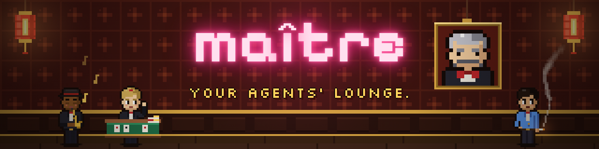
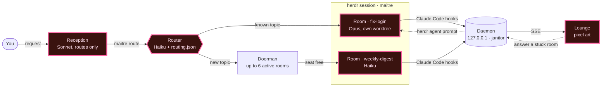

<p align="center">
  
</p>

<h3 align="center">Your agents' lounge.</h3>

<p align="center">
  A terminal orchestrator for Claude Code agents, with a pixel-art lounge where you watch them work.
</p>

<p align="center">
  <a href="LICENSE"></a>
  <a href="package.json"></a>
  
  <a href="#roadmap"></a>
</p>

<p align="center">
  
</p>

> [!NOTE]
> **maître is early.** What runs today is **M2a: type `maitre` and you get a herdr session with a reception and the live lounge.** The reception routes each request to a room, a Claude Code session in its own git worktree and herdr tab, on the model the task calls for. The demo mode and rooms opened by hand with `maitre room run` still work. The doorman, the janitor, the building and answering from the lounge are the design being built next. Sections below mark what is planned, and the [Roadmap](#roadmap) tracks it.

## What is it


This is what maître is being built to do. Today you write requests at the reception, they land in rooms, and you watch the rooms in the lounge; the rest arrives milestone by milestone.

Running one coding agent is easy. Running five is a juggling act: which tab had the failing test, which conversation was about the login bug, which worktree is safe to delete.

maître runs the room for you, like the maître d' of a busy lounge.

- **A reception, not a chat log.** You write every request in one place. The reception does no work itself: it sends the request to the room that already handles that topic, or opens a new one.
- **One room per topic, named for you.** Each room is a real, interactive Claude Code session in its own git worktree, named after its topic (`fix-login`, `weekly-digest`). You can walk into any room and talk to it directly.
- **The right model for the job.** A routing table maps each kind of task to a model: Haiku for reading, summarizing and naming; Sonnet for the reception, exploration and clear changes; Opus for development; Fable as the advisor before big decisions. Each room records how it went, so routing learns.
- **A janitor that never loses work.** A room idle for 4 hours with nothing pending (no uncommitted change, no unpushed commit, no open PR, no open question) closes on its own and leaves minutes in a markdown vault. Anything with loose ends goes to the couch instead.
- **A lounge you can leave open all day.** A pixel-art building where every agent's place tells you its state at a glance, and where the one agent that needs you rings the bell.

## Features

What you can run today is marked **today**: it works with real rooms as well as in the demo. Everything else is the design, tagged with the milestone that brings it.

| | Feature | When |
|---|---|---|
|  | **Card table.** A working agent plays cards while it uses its tools. | **today** |
|  | **Slot machines.** A subagent pulls the lever while it works. The lever is yours to pull too, jackpot included. | **today** |
|  | **The musician.** Click him for live, generative **jazz** (walking bass, swung ride, ii-V-I, a synth sax) or **house** (four-on-the-floor, off-beat hats, chord stabs). Made with WebAudio, no recordings. | **today** |
|  | **The bell.** An agent that needs you goes to the reception desk with a red "!" and a sound. Click it to see the reason and the options (in the demo, with the recommended one marked). | **today**; you answer in the room's terminal (from the lounge in M5) |
|  | **Ready, quietly.** An agent that finished its turn without asking anything waits at the bar with a green check. No sound. | **today** |
|  | **Reception and rooms.** One request box, one room per topic, automatic names, and the project found from an index of your repos. | **today** in the terminal; a clickable reception in the lounge in M2b |
|  | **Model routing** by task type, applied by code, with outcomes that feed back into the router. | **today** by task type; learning in M5 |
|  | **Doorman.** At most 6 active rooms at once (configurable); the rest queue on the sidewalk. | M3 |
|  | **Janitor.** Closes idle rooms with nothing pending and writes minutes to an Obsidian-compatible vault. | M3 |
|  | **The building.** One themed floor per project, a lobby, a shared smoking terrace and an elevator. | M4 |
|  | **Answer from anywhere.** Reply to a stuck room from the lounge, chat with a room from its panel, or pick an option straight from a desktop notification. | M5 |

## Quick start

### Requirements

- **Node.js 20 or newer.**
- **Linux.** macOS is planned, and nothing in the design blocks it.
- **Chrome or Chromium** (optional): the lounge opens as an app window with `--app`. Without it, maître falls back to your default browser.
- **For real rooms:** [Claude Code](https://docs.anthropic.com/en/docs/claude-code), with `claude` on your `PATH`.
- **For the reception and rooms:** [herdr](https://herdr.dev) (tested with 0.8.2), Claude Code (tested with 2.1), and `git`. Your projects are local clones with an `origin` remote.
- **Claude Code auth:** whatever already works for `claude` works in maître. API keys, gateways (`ANTHROPIC_BASE_URL`), Bedrock, Vertex and `CLAUDE_CONFIG_DIR` pass through to herdr, the reception and the rooms; only the session markers of a Claude Code you launch `maitre` from are dropped.

### Run the demo lounge (works today)

```sh
git clone https://github.com/danielrdg/maitre
cd maitre
npm install
npm run build
npm run demo          # same as: node bin/maitre lounge --demo
```

maître starts a small server on `127.0.0.1`, prints the lounge URL with its access token, and opens the window. Press `Ctrl+C` to stop.

```text
maitre                                   open the reception and the lounge in herdr
maitre index [--root <dir>]...           scan your repos for the project index
maitre projects                          list the indexed projects
maitre room list                         rooms, their herdr status and lounge state
maitre room send <room> "<text>"         send a room a message without waiting for its turn
maitre room close <room>                 exit a room and close its tab (its folder is kept)
maitre room open <name> [--project <p>] --model <m> --task <type> (--brief "<text>" | --brief-file <path>)
maitre route <id> [<id>...] [--json]     what the reception runs: classify a request
maitre dispatch <id>                     what the reception runs: open or feed the room
maitre lounge [--demo] [--port <n>] [--no-open] [--lang en|pt-BR]
maitre room run <name> [--brief-file <path>] [-- <claude args>]
maitre status <working|waiting|blocked> "<text>" [--option <o>]...

  --demo        Run the lounge with simulated agents
  --port <n>    Preferred port (default 8737; falls back to the next free one)
  --no-open     Do not open a browser window
  --lang <l>    Interface language: en or pt-BR (default en)
```

Want `maitre` on your `PATH`? Run `npm link` once from the clone.

`npm install` reports dev-only advisories in `extract-zip`, which `puppeteer-core` uses only to download a browser; the asset script uses your system Chrome instead, so that path never runs. Do not run `npm audit fix --force`: it downgrades `puppeteer-core` and breaks `npm run assets`.

In the demo, the **demo** menu in the corner lets you block an agent, merge a PR and send a new room to the queue. Click any agent for its panel, pull a slot lever, and click the musician for music. Sound starts after your first click, as browsers require.

### Your first reception (works today)

Put `maitre` on your `PATH` (`npm link`, above), tell it where your repos live, and open it:

```sh
maitre index --root ~/code     # finds git repos up to two levels down; run it again after adding repos
maitre projects                # what it found: name, base branch, path
maitre                         # opens herdr with the reception and the lounge
```

`maitre` starts a herdr session named `maitre` with two tabs, **reception** and **lounge**, opens the lounge window and attaches you to herdr, on the reception. Detach with herdr's detach key (`Ctrl+B` then `Q` by default): everything keeps running. Run `maitre` again to come back; it reuses the tabs that are alive and creates only what is missing. The lounge window opens only when the lounge itself (re)starts, so after closing it, open the lounge tab's URL by hand.

**The first launch.** Claude Code asks whether you trust a folder the first time it starts there. maître answers that dialog on screen only for its own folders: the reception's folder (`$MAITRE_HOME/reception`) and the scratch folders. It never answers for a room worktree, because Claude Code records a worktree's trust under the project's main clone (as of Claude Code 2.1), and that choice is yours. When a new worktree room shows the dialog, the room still opens, `maitre dispatch` and `maitre room open` say "answer the folder-trust question in its tab", and the lounge rings until you answer it there. Once you trust a project, its later rooms start without asking. maître never edits Claude Code's config files itself.

**What the reception does.** You type a request (*fix the login redirect in backend*). A hook saves your words to a file and gives the request a number. The reception then runs `maitre route <id>`, a short Haiku call that sees the project index and the open rooms and picks the project, the room and the kind of task. Then `maitre dispatch <id>` opens a new room or sends the request to the room that already handles the topic. If the request is unclear, the reception asks you one question first. It also answers "what's going on?" (`maitre room list`), "which projects do you know?" and "close fix-login".

**What it does not do.** The reception never does the work: it does not read code, edit files or answer technical questions. Its only tool is Bash, and a guard hook lets through only a short allowlist of `maitre` commands that take numbers and room names, nothing else; your words never become part of a command line. It runs with Claude Code's setting sources off, so your settings, hooks and plugins do not load into it. Claude Code still loads your user and organization `CLAUDE.md` (and any claude.ai connectors you have) into it, which costs some tokens, but the guard denies every other command and tool, so they cannot widen what it can run.

**Which model.** The reception runs on Sonnet. To try it cheaper, start it with `MAITRE_RECEPTION_MODEL=haiku maitre` (it applies when the reception tab is created). Rooms get their model from the kind of task, through [`config/routing.json`](config/routing.json):

| Task type | Model | For |
|---|---|---|
| `simple` | Haiku | A quick lookup or a trivial answer |
| `explore` | Sonnet | Reading and research, no changes |
| `change` | Sonnet | A small or medium code change |
| `build` | Opus | A new feature or a large piece of work |
| `decide` | Opus | A design or architecture decision |

Haiku names the task type and code picks the model, and an unknown type gets Sonnet. Inside a room, Claude can hand reading to a `reader` subagent on Haiku and research to an `explorer` on Sonnet.

**Where the work happens.** A room for a project gets a git worktree at `$MAITRE_HOME/worktrees/<project>/<room>`, on a new branch `maitre/<room>` cut from `origin/<base>` after a `git fetch`, from your local clone (nothing is cloned). A request without a project gets a scratch folder at `$MAITRE_HOME/scratch/<room>`. Each room is a herdr tab named `<project> / <room>` running your own Claude Code with `--permission-mode auto`, so your skills and global rules work there. Walk into the tab to talk to it. Follow-ups typed at the reception go to the room that has the topic; a room that is waiting on you (a permission or a question) is not interrupted, and the reception tells you to answer it in its tab. From any terminal, `maitre room send <room> "<text>"` does the same.

**Closing a room.** Tell the reception "close fix-login", or run `maitre room close fix-login`: an idle room gets `/exit` first, then the tab closes. A room that is still working is closed mid-turn: the tab closes and that turn is cut off, so wait for it to finish if you want its result. The worktree, the branch and the scratch folder stay; M2a never deletes them, and opening a room with the same name later reuses them and says so. When you are done with one, remove it by hand from your clone (`git worktree remove <path>`, then `git branch -d maitre/<room>`). The janitor that closes idle rooms safely comes in M3. If a room's Claude dies or herdr restarts, `maitre room list` shows the room as `not running`, and the next `maitre` closes its leftover tab.

### Watch a real room by hand (works today)

Run the lounge without `--demo` in one terminal, and open a room in another, from the folder you want Claude Code to work in:

```sh
maitre lounge                                         # terminal 1: the lounge, live
maitre room run fix-login -- --permission-mode auto   # terminal 2: Claude Code, as a room
```

Both commands use `maitre` from your `PATH` (`npm link`, above), because the room runs in your project's folder, not in the clone.

`maitre room run <name>` starts your own `claude` with maître's hooks for that session only (passed with `--settings`; your global Claude Code settings are not touched) and a short note in the system prompt. Anything after `--` goes to `claude`, except `--settings` and the `--append-system-prompt` flags, which maître sets itself. The room walks in with a coffee, plays cards while it works, sends its subagents to the slot machines, rings the bell when a permission or a question waits for you, and waits at the bar when its turn ends. It switches to whisky when it opens a PR and walks out when you leave Claude Code. You answer in the room's terminal; answering from the lounge comes in M5. Open as many rooms as you like, each with its own name: two rooms open at the same time must not share one, and names that differ only in case or punctuation (`Fix Login`, `fix-login`) count as the same.

Inside a room, the agent can say what it is doing with `maitre status`, which maître puts on the room's `PATH`. The system prompt asks it to run `maitre status waiting "<what>"` when it waits on something outside its control (CI, a build, a review bot), which sends it to the terrace, and `maitre status working "<what>"` when it resumes. `maitre status blocked "<question>" --option <a> --option <b>` rings the bell with that question and its options. The command only works inside a room: it reads the room name from `MAITRE_ROOM`, which `maitre room run` sets.

Rooms write their events to `~/.maitre/state/rooms/<room>/events.jsonl`, and the lounge reads them from there. Set `MAITRE_HOME` to use another folder; the lounge and the rooms must use the same one. To see a room without starting Claude Code, replay the recorded hook events into a running lounge. Always set `MAITRE_HOME` for both commands (the replay script refuses to run without it), so the replayed room never lands in your real `~/.maitre`:

```sh
MAITRE_HOME=/tmp/maitre-try node bin/maitre lounge     # terminal 1
MAITRE_HOME=/tmp/maitre-try node scripts/replay-events.mjs test/fixtures/hook-events.jsonl --room replay --delay 800   # terminal 2
```

A room's `events.jsonl` holds what its hooks saw: the start of each prompt, tool inputs (shell commands, file paths, snippets of edited files), questions and their answers, and the last assistant message. It stays on your machine, readable only by you (mode 0600); the lounge serves only the room state it derives from it, on 127.0.0.1 and behind its token. To clean up, delete a room's folder (`$MAITRE_HOME/state/rooms/<room>`, where `MAITRE_HOME` is `~/.maitre` unless you set it) or the whole `$MAITRE_HOME/state`.

A room leaves the lounge when Claude Code ends, even after a crash, because `maitre room run` reports the exit. If `maitre room run` dies too (a reboot, an out-of-memory kill, `kill -9` on its process group), nothing reports it and the room stays in the lounge: delete `$MAITRE_HOME/state/rooms/<room>` and restart the lounge, or run a room with the same name again.

### One-step setup (coming in M2b)

This is where the quick start is headed. It does **not** work yet:

```sh
git clone https://github.com/danielrdg/maitre
cd maitre
./setup               # asks where your repos live, installs the app icon and the Super+M prompt
maitre                # opens herdr, the reception and the lounge
```

## How it works

This is the target design (M1 to M5; the dashed answer path is M5). Today (M2a) the reception, the router, rooms in herdr with their own worktrees, the hooks and the lounge exist (highlighted below); the daemon is the part of `maitre lounge` that reads the rooms' events and streams them over SSE. The doorman and the janitor come in M3.



1. **You write in the reception**, a Sonnet session in herdr. It cannot do the work itself: its tools are restricted and a hook denies anything that is not a `maitre` command.
2. **`maitre route` asks Haiku** where the request belongs, given the project index and the open rooms (recent minutes and past routing outcomes join in M3 and M5). Haiku picks the project, the room and the task type; code picks the model from `config/routing.json`.
3. **A known topic goes to its room.** A new topic gets a new room: a worktree on a `maitre/<room>` branch, a herdr tab, and `claude` started with a short brief. From M3, if six rooms are already active, it waits in line.
4. **Every room reports through Claude Code hooks.** One small hook forwards each event to the daemon and never blocks the agent. Rooms can also declare `maitre status waiting|blocked`.
5. **The daemon pushes state to the lounge over SSE.** Answers you give in the lounge go back to the room through herdr.

The lounge server listens on `127.0.0.1` only and requires a random token. Text coming from agents is always rendered as text, never as HTML.

The full design, including the open spikes, is in [docs/design.md](docs/design.md).

## The lounge

The lounge is the point. It is pixel art drawn entirely by code: no sprite sheets, no third-party assets. It uses the [Pixelify Sans](https://fonts.google.com/specimen/Pixelify+Sans) and [Silkscreen](https://fonts.google.com/specimen/Silkscreen) fonts, both under the SIL Open Font License.

**Today** there is one floor in the house style, a lacquered Chinese hall under red lanterns:

- a **sidewalk queue** behind a velvet rope, watched by the doorman;
- the **card table**, the **slot machines**, and the **bar**, with coffee for newcomers and whisky for deliveries;
- the **moon gate**, where Fable, the house advisor, holds court with a cigar;
- the **reception desk**, where the maître rings the bell for agents that need you;
- the **couch**, the **dance floor** under a mirror ball, and the **terrace** for smokers;
- the **musician**, who plays jazz or house on request.

The interface stays out of the way. The stage fills the window; a corner holds **Sound** and **Names** buttons and a **?** that opens the model color legend. The **demo** menu shows up only with `--demo`. The lounge also speaks Portuguese: `--lang pt-BR`.

**Coming in M4: the building.** At night, the facade is the overview: one lit floor per project, the floor with a stuck agent blinking red, and an elevator to move between them. Each project gets a party theme, so you recognize it at a glance: Chinese hall, neon casino, art deco speakeasy, tiki bar, Tokyo karaoke, rooftop garden. The ground floor is the lobby with the reception and the queue; the roof is the shared smoking terrace.

**Model colors** tell you who is working:

<p>
  
  
  
  
</p>

## States

**The place tells the state.** You never read a status line: you look at where the agent is. The demo plays every state with simulated agents. Real rooms drive the coffee, the cards, the slots, the terrace, the bell, the bar, the whisky and the exit; the other places (the queue, the couch, the dance floor, Fable) arrive with later milestones.

<p align="center">
  
</p>

| State | Where | What the agent does | Sound |
|---|---|---|---|
| Queued, waiting for a seat | Sidewalk | Waits behind the rope for the doorman | |
| New room, planning | Bar | Drinks coffee | |
| Working | Card table | Plays cards, one per tool used | |
| Subagent at work | Slot machines | Pulls the lever | |
| Waiting on something outside | Terrace | Smokes while CI, a build or a bot runs | |
| Consulting Fable | Moon gate | Talks to the house advisor | |
| House advisor | Moon gate | Fable himself, with a cigar | |
| **Needs you** | Reception desk | Rings the bell, with a red "!" overhead | **bell** |
| Ready for you to look | Bar counter | A colorful drink and a green check (clicking shows the room's task and last steps) | none, on purpose |
| Delivered, waiting for merge | Bar | Whisky | |
| Merged! Celebrating | Dance floor | Dances under fireworks, then leaves | fanfare |
| Parked with a pending item | Couch | Naps until the loose end is resolved | |
| Leaving | Door | Walks out | |

Outside the terrace, smoke is only atmosphere: each agent has a random smoking habit and lights up now and then in the queue, at the table or on the couch. It never changes the state. On the terrace, everyone smokes.

The bell rings only for a real block: a pending permission, a question with options, or a room that declares itself blocked. Start rooms with Claude Code's `--permission-mode auto` (after `--`), so routine actions go through and only risky ones and questions ring the bell.

## Configuration

**Today** the settings are the CLI flags in [Quick start](#quick-start), a few environment variables and one config file:

- `MAITRE_HOME` (default `~/.maitre`): where maître keeps everything it writes: the config, the project index, room events, briefs, worktrees and scratch folders. The lounge, the reception and the rooms must use the same one.
- `MAITRE_HERDR_SESSION` (default `maitre`): the herdr session `maitre` opens.
- `MAITRE_RECEPTION_MODEL` (default `sonnet`): the reception's model, read when the reception tab is created.
- `$MAITRE_HOME/config.json`: your project roots (`maitre index --root <dir>` adds them) and per-project overrides, as below.

**Planned** settings are tagged with their milestone. Versioned defaults live in `config/`, tracked in git; anything personal stays in `$MAITRE_HOME`, out of git.

| Setting | Default | What it does | Milestone |
|---|---|---|---|
| Routing table | `config/routing.json` | Maps each task type to a model. Code applies it; a follow-up goes to its room as it is, on the room's model. | **today** |
| Project roots | none | `roots` in `$MAITRE_HOME/config.json`: folders `maitre index` scans for repos. `./setup` will ask for them in M2b. | **today** |
| Base branch | the remote's `HEAD` | Per project, e.g. `"projects": { "backend": { "base": "dev" } }`. Worktrees branch from it. | **today** |
| Branch prefix | `maitre/` | Per project, `"branchPrefix"`, to match each repo's convention. | **today** |
| Doorman cap | `6` active rooms | Rooms on the couch or waiting for merge don't count. | M3 |
| Janitor idle time | `4h` | A room idle this long with nothing pending closes and leaves minutes. Checked every 5 minutes. | M3 |
| `pr.autoWake` | `false` | After a PR opens, maître only tells you about CI failures and review comments. Set it to `true` to let maître wake the room. | M3 |
| Floor theme | automatic | Per project, `theme: <id>` picks a party theme. | M4 |

The routing table as it ships (`config/routing.json`); the task types are described in [Your first reception](#your-first-reception-works-today):

```json
{
  "simple": "haiku",
  "explore": "sonnet",
  "change": "sonnet",
  "build": "opus",
  "decide": "opus"
}
```

## maître vs firstmate

maître exists because of [firstmate](https://github.com/kunchenguid/firstmate), the agent distro that turns one conversation into a crew of agents, and [shipmate](https://github.com/bpsanti/shipmate), the dashboard that showed how good it feels to *see* that crew. maître borrows their best ideas and makes a different bet: a room per topic, routing by code, and a lounge that is part of the product.

Every firstmate cell below comes from firstmate's (or, for the dashboard, shipmate's) docs, linked at the commit that was checked. maître cells marked *planned* do not exist yet.

| | firstmate | maître |
|---|---|---|
| Who you talk to | One liaison: you talk only to the first mate, which dispatches and supervises the crew ([README][fm-features]) | A reception that sends each topic to its own named room, and any room you can talk to directly (M2a) |
| Cleaning up | Teardown after a task ships or reports, refusing dirty worktrees and unlanded work ([architecture][fm-teardown]) | The same never-lose-work rule, plus a janitor that closes rooms idle for 4 h with nothing pending and writes minutes (*planned, M3*) |
| Choosing a model | A static crew harness or dispatch profiles, with an optional typed resolver ([architecture][fm-dispatch]) | A routing table applied by code (M2a), with each room's outcome (model, tokens, time, redo, merged or not) fed back to the router (*planned, M5*) |
| Always-loaded instructions | `AGENTS.md`, imported by `CLAUDE.md` ([CLAUDE.md][fm-claude]): about 7,350 words at the checked commit | A reception contract capped at 1,500 words, about 600 today (M2a); your own `CLAUDE.md` files still load into it |
| Watching the agents | The session backend's panes; shipmate, a separate project, adds a dashboard refreshed every 30 seconds where you can also answer decisions and queue tasks ([shipmate][sm]) | A built-in lounge updated live over SSE (M1) |
| Harnesses | Claude Code, Grok, Pi, Codex, OpenCode, Cursor and more ([README][fm-req]) | Claude Code only |
| Session backends | tmux by default, herdr, and experimental ones such as Zellij, cmux and Orca ([README][fm-crew], [backends][fm-backends]) | herdr only |
| Platforms | macOS and Linux ([README][fm-top]) | Linux; macOS later |
| Maturity | Shipping today, with a large [test suite][fm-tests] | Early: the reception, rooms in worktrees and the lounge (M2a) |

If you need many harnesses, many backends, macOS, or a mature tool today, use firstmate. If you live in Claude Code and herdr and want each topic in its own room with a lounge to watch, maître is being built for you.

[fm-top]: https://github.com/kunchenguid/firstmate/blob/64254de47a2989add6412949e98c36e3964b24aa/README.md?plain=1#L1-L19
[fm-features]: https://github.com/kunchenguid/firstmate/blob/64254de47a2989add6412949e98c36e3964b24aa/README.md?plain=1#L44
[fm-crew]: https://github.com/kunchenguid/firstmate/blob/64254de47a2989add6412949e98c36e3964b24aa/README.md?plain=1#L45
[fm-backends]: https://github.com/kunchenguid/firstmate/blob/64254de47a2989add6412949e98c36e3964b24aa/README.md?plain=1#L145-L147
[fm-req]: https://github.com/kunchenguid/firstmate/blob/64254de47a2989add6412949e98c36e3964b24aa/README.md?plain=1#L62
[fm-teardown]: https://github.com/kunchenguid/firstmate/blob/64254de47a2989add6412949e98c36e3964b24aa/docs/architecture.md?plain=1#L469
[fm-dispatch]: https://github.com/kunchenguid/firstmate/blob/64254de47a2989add6412949e98c36e3964b24aa/docs/architecture.md?plain=1#L367-L371
[fm-claude]: https://github.com/kunchenguid/firstmate/blob/64254de47a2989add6412949e98c36e3964b24aa/CLAUDE.md?plain=1#L2
[fm-tests]: https://github.com/kunchenguid/firstmate/tree/64254de47a2989add6412949e98c36e3964b24aa/tests
[sm]: https://github.com/bpsanti/shipmate/blob/78f90de2cb78f00cf482326ba9a15ef9ef229439/README.md?plain=1#L7-L8

## FAQ

**Does it work today?**
Yes, in the terminal: `maitre` opens the reception, which routes your requests to rooms in their own worktrees, and the lounge shows them live. It also has a demo mode with simulated agents. The one-step setup and a clickable reception (M2b), the doorman and janitor (M3), the building (M4) and answering from the lounge (M5) are the roadmap.

**Why herdr and not tmux?**
herdr gives each room a real tab you can walk into, plus the `agent prompt`, `send-keys` and `read` commands that should let the lounge answer a stuck room (spike 2 in the [design](docs/design.md) checks this). v1 targets one session manager to stay small.

**Why only Claude Code?**
Rooms are your own Claude Code sessions: your skills, plugins and global rules keep working inside them. Other harnesses are a non-goal for v1.

**Will the janitor delete my work?** *(planned, M3)*
No. A room closes only when it has no uncommitted change, no unpushed commit, no open PR and no open question. The worktree is removed with `git worktree remove`, never `--force`, and the branch stays. Anything else goes to the couch, with the reason shown.

**Does the lounge load anything from the internet?**
No. The server binds to `127.0.0.1`, the lounge needs the token printed at startup (kept in a same-site cookie after the first load), and the art and music are generated by code in your browser.

**Where does the music come from?**
It is generated live with WebAudio: chords, bass lines and the sax solo are composed on the fly. No recordings, so no copyright.

**Why "maître"?**
The maître d' greets you at the door, finds you the right table and keeps the room running. He is also the mascot: grey slicked hair, a moustache, a red bow tie.

## Roadmap

- [x] **M0 · The lounge:** repo, CLI with a token-gated local server, the pixel lounge in demo mode, music, agent panel, slot machines, English and Portuguese.
- [x] **M1 · Events:** the Claude Code hook, `maitre room run` and `maitre status`, the daemon, and the lounge showing real rooms over SSE.
- [x] **M2a · Reception and rooms:** `maitre` and `maitre index`; the guarded reception and the Haiku router; rooms in herdr with their own worktrees and the model their task calls for; each room's project and branch in the lounge.
- [ ] **M2b · The doors:** `./setup`, a clickable reception in the lounge, the app icon, the daemon as a login service, and the Super+M quick prompt.
- [ ] **M3 · Doorman and janitor:** the queue and the 6-room cap, cleanup with minutes, and the markdown vault.
- [ ] **M4 · The building:** the facade, themed floors, lobby, terrace and elevator.
- [ ] **M5 · Answer from the lounge:** reply to a stuck room from its panel, chat with a room, desktop notifications with action buttons, and routing that learns from outcomes.

## Credits

- [firstmate](https://github.com/kunchenguid/firstmate), for the agent distro and the crew working in worktrees.
- [shipmate](https://github.com/bpsanti/shipmate), for showing what a live view of the crew can feel like.
- [Pixelify Sans](https://fonts.google.com/specimen/Pixelify+Sans) and [Silkscreen](https://fonts.google.com/specimen/Silkscreen), under the SIL Open Font License.

Contributions are welcome: see [CONTRIBUTING.md](CONTRIBUTING.md).

## License

MIT. See [LICENSE](LICENSE).
