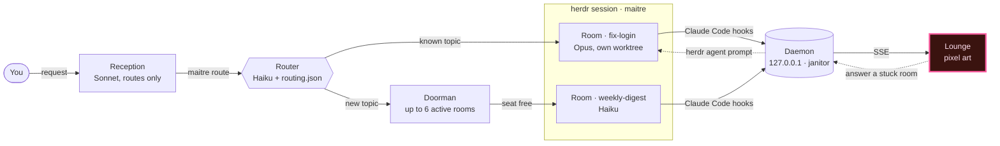
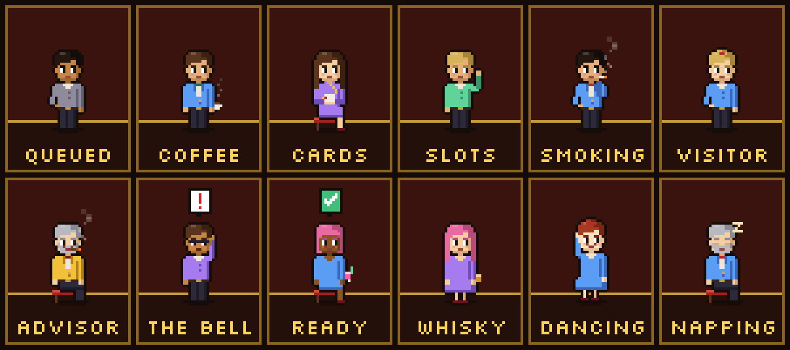

<p align="center">
  
</p>

<h3 align="center">Your agents' lounge.</h3>

<p align="center">
  A terminal orchestrator for Claude Code agents, with a pixel-art lounge where you watch them work.
</p>

<p align="center">
  <a href="LICENSE"></a>
  <a href="package.json"></a>
  
  <a href="#roadmap"></a>
</p>

<p align="center">
  
</p>

> [!NOTE]
> **maître is early.** What runs today is **M0: the lounge in demo mode**, with simulated agents. The orchestrator described below (reception, rooms, routing, janitor) is the design being built next. Sections below mark what is planned, and the [Roadmap](#roadmap) tracks it.

## What is it


This is what maître is being built to do. Today you can try the lounge; the rest arrives milestone by milestone.

Running one coding agent is easy. Running five is a juggling act: which tab had the failing test, which conversation was about the login bug, which worktree is safe to delete.

maître runs the room for you, like the maître d' of a busy lounge.

- **A reception, not a chat log.** You write every request in one place. The reception does no work itself: it sends the request to the room that already handles that topic, or opens a new one.
- **One room per topic, named for you.** Each room is a real, interactive Claude Code session in its own git worktree, named after its topic (`fix-login`, `weekly-digest`). You can walk into any room and talk to it directly.
- **The right model for the job.** A routing table maps each kind of task to a model: Haiku for reading, summarizing and naming; Sonnet for the reception, exploration and clear changes; Opus for development; Fable as the advisor before big decisions. Each room records how it went, so routing learns.
- **A janitor that never loses work.** A room idle for 4 hours with nothing pending (no uncommitted change, no unpushed commit, no open PR, no open question) closes on its own and leaves minutes in a markdown vault. Anything with loose ends goes to the couch instead.
- **A lounge you can leave open all day.** A pixel-art building where every agent's place tells you its state at a glance, and where the one agent that needs you rings the bell.

## Features

What you can run today is marked **today**; **today (demo)** means it runs in the demo lounge, driven by simulated agents. Everything else is the design, tagged with the milestone that brings it.

| | Feature | When |
|---|---|---|
|  | **Card table.** A working agent plays cards, one card per tool it uses. | **today (demo)** |
|  | **Slot machines.** A subagent reading files pulls the lever. The lever is yours to pull too, jackpot included. | **today (demo)** |
|  | **The musician.** Click him for live, generative **jazz** (walking bass, swung ride, ii-V-I, a synth sax) or **house** (four-on-the-floor, off-beat hats, chord stabs). Made with WebAudio, no recordings. | **today** |
|  | **The bell.** An agent that needs you goes to the reception desk with a red "!" and a sound. Click it to see the reason and the options, with the recommended one marked. | **today (demo)**, answers are simulated |
|  | **Ready, quietly.** An agent that finished its turn without asking anything waits at the bar with a green check. No sound. | **today (demo)** |
|  | **Reception and rooms.** One request box, one room per topic, automatic names, and the project found from an index of your repos. | M2 |
|  | **Model routing** by task type, applied by code, with outcomes that feed back into the router. | M2, learning in M5 |
|  | **Doorman.** At most 6 active rooms at once (configurable); the rest queue on the sidewalk. | M3 |
|  | **Janitor.** Closes idle rooms with nothing pending and writes minutes to an Obsidian-compatible vault. | M3 |
|  | **The building.** One themed floor per project, a lobby, a shared smoking terrace and an elevator. | M4 |
|  | **Answer from anywhere.** Reply to a stuck room from the lounge, chat with a room from its panel, or pick an option straight from a desktop notification. | M5 |

## Quick start

### Requirements

- **Node.js 20 or newer.**
- **Linux.** macOS is planned, and nothing in the design blocks it.
- **Chrome or Chromium** (optional): the lounge opens as an app window with `--app`. Without it, maître falls back to your default browser.
- **For the orchestrator (roadmap, M2):** [herdr](https://herdr.dev) and [Claude Code](https://docs.anthropic.com/en/docs/claude-code), plus the GitHub CLI (`gh`), authenticated.

### Run the demo lounge (works today)

```sh
git clone https://github.com/danielrdg/maitre
cd maitre
npm install
npm run build
npm run demo          # same as: node bin/maitre lounge --demo
```

maître starts a small server on `127.0.0.1`, prints the lounge URL with its access token, and opens the window. Press `Ctrl+C` to stop.

```text
maitre lounge [--demo] [--port <n>] [--no-open] [--lang en|pt-BR]

  --demo        Run the lounge with simulated agents
  --port <n>    Preferred port (default 8737; falls back to the next free one)
  --no-open     Do not open a browser window
  --lang <l>    Interface language: en or pt-BR (default en)
```

Want `maitre` on your `PATH`? Run `npm link` once from the clone.

`npm install` reports dev-only advisories in `extract-zip`, which `puppeteer-core` uses only to download a browser; the asset script uses your system Chrome instead, so that path never runs. Do not run `npm audit fix --force`: it downgrades `puppeteer-core` and breaks `npm run assets`.

In the demo, the **demo** menu in the corner lets you block an agent, merge a PR and send a new room to the queue. Click any agent for its panel, pull a slot lever, and click the musician for music. Sound starts after your first click, as browsers require.

### The full orchestrator (coming in M2)

This is where the quick start is headed. It does **not** work yet:

```sh
git clone https://github.com/danielrdg/maitre
cd maitre
./setup               # asks where your repos live, installs the app icon and the Super+M prompt
maitre                # opens herdr, the reception and the lounge
```

## How it works

This is the target design (M1 to M5; the dashed answer path is M5). Today only the **Lounge** box exists, fed by the demo simulator instead of the daemon.



1. **You write in the reception**, a Sonnet session in herdr. It cannot do the work itself: its tools are restricted and a hook denies anything that is not a `maitre` command.
2. **`maitre route` asks Haiku** where the request belongs, given the project index, the open rooms, recent minutes and past routing outcomes. Haiku picks the project and the room; code picks the model from `config/routing.json`.
3. **A known topic goes to its room.** A new topic gets a new room: a worktree on a `maitre/<room>` branch, a herdr tab, and `claude` started with a short brief. If six rooms are already active, it waits in line.
4. **Every room reports through Claude Code hooks.** One small hook forwards each event to the daemon and never blocks the agent. Rooms can also declare `maitre status waiting|blocked`.
5. **The daemon pushes state to the lounge over SSE.** Answers you give in the lounge go back to the room through herdr.

The lounge server listens on `127.0.0.1` only and requires a random token. Text coming from agents is always rendered as text, never as HTML.

The full design, including the open spikes, is in [docs/design.md](docs/design.md).

## The lounge

The lounge is the point. It is pixel art drawn entirely by code: no sprite sheets, no third-party assets. It uses the [Pixelify Sans](https://fonts.google.com/specimen/Pixelify+Sans) and [Silkscreen](https://fonts.google.com/specimen/Silkscreen) fonts, both under the SIL Open Font License.

**Today (M0)** there is one floor in the house style, a lacquered Chinese hall under red lanterns:

- a **sidewalk queue** behind a velvet rope, watched by the doorman;
- the **card table**, the **slot machines**, and the **bar**, with coffee for newcomers and whisky for deliveries;
- the **moon gate**, where Fable, the house advisor, holds court with a cigar;
- the **reception desk**, where the maître rings the bell for agents that need you;
- the **couch**, the **dance floor** under a mirror ball, and the **terrace** for smokers;
- the **musician**, who plays jazz or house on request.

The interface stays out of the way. The stage fills the window; a corner holds **Sound** and **Names** buttons and a **?** that opens the model color legend. The **demo** menu shows up only with `--demo`. The lounge also speaks Portuguese: `--lang pt-BR`.

**Coming in M4: the building.** At night, the facade is the overview: one lit floor per project, the floor with a stuck agent blinking red, and an elevator to move between them. Each project gets a party theme, so you recognize it at a glance: Chinese hall, neon casino, art deco speakeasy, tiki bar, Tokyo karaoke, rooftop garden. The ground floor is the lobby with the reception and the queue; the roof is the shared smoking terrace.

**Model colors** tell you who is working:

<p>
  
  
  
  
</p>

## States

**The place tells the state.** You never read a status line: you look at where the agent is. Today the demo plays every state with simulated agents; from M1 on, real rooms drive them.

<p align="center">
  
</p>

| State | Where | What the agent does | Sound |
|---|---|---|---|
| Queued, waiting for a seat | Sidewalk | Waits behind the rope for the doorman | |
| New room, planning | Bar | Drinks coffee | |
| Working | Card table | Plays cards, one per tool used | |
| Subagent reading files | Slot machines | Pulls the lever on every read | |
| Waiting on something outside | Terrace | Smokes while CI, a build or a bot runs | |
| Consulting Fable | Moon gate | Talks to the house advisor | |
| House advisor | Moon gate | Fable himself, with a cigar | |
| **Needs you** | Reception desk | Rings the bell, with a red "!" overhead | **bell** |
| Ready for you to look | Bar counter | A colorful drink and a green check (from M1, clicking shows the room's last message) | none, on purpose |
| Delivered, waiting for merge | Bar | Whisky | |
| Merged! Celebrating | Dance floor | Dances under fireworks, then leaves | fanfare |
| Parked with a pending item | Couch | Naps until the loose end is resolved | |
| Leaving | Door | Walks out | |

Outside the terrace, smoke is only atmosphere: each agent has a random smoking habit and lights up now and then in the queue, at the table or on the couch. It never changes the state. On the terrace, everyone smokes.

The bell rings only for a real block: a pending permission, a question with options, or a room that declares itself blocked. Rooms run with Claude Code's `--permission-mode auto`, so routine actions go through and only risky ones ring the bell.

## Configuration

**Today** the only settings are the CLI flags in [Quick start](#quick-start).

**Planned.** Everything below is the design for M2 to M4. Defaults will live in `config/`, tracked in git; anything personal (`state/`, `memory/`, `config/*.local.*`) stays out of git.

| Setting | Default | What it does | Milestone |
|---|---|---|---|
| Routing table | `config/routing.json` | Maps each task type to a model. Code applies it, and the router never downgrades a running room unless you ask. | M2 |
| Project roots | `config/projects.roots` | Folders `maitre index` scans for repos. Set during `./setup`. | M2 |
| Base branch | the remote's `HEAD` | Per project, e.g. `dev`. Worktrees branch from it. | M2 |
| Branch prefix | `maitre/` | Per project, to match each repo's convention. | M2 |
| Doorman cap | `6` active rooms | Rooms on the couch or waiting for merge don't count. | M3 |
| Janitor idle time | `4h` | A room idle this long with nothing pending closes and leaves minutes. Checked every 5 minutes. | M3 |
| `pr.autoWake` | `false` | After a PR opens, maître only tells you about CI failures and review comments. Set it to `true` to let maître wake the room. | M3 |
| Floor theme | automatic | Per project, `theme: <id>` picks a party theme. | M4 |

An illustrative `config/routing.json` (the schema may change before M2):

```json
{
  "read": "haiku",
  "summarize": "haiku",
  "name": "haiku",
  "reception": "sonnet",
  "explore": "sonnet",
  "clear-change": "sonnet",
  "develop": "opus",
  "advisor": "fable"
}
```

## maître vs firstmate

maître exists because of [firstmate](https://github.com/kunchenguid/firstmate), the agent distro that turns one conversation into a crew of agents, and [shipmate](https://github.com/bpsanti/shipmate), the dashboard that showed how good it feels to *see* that crew. maître borrows their best ideas and makes a different bet: a room per topic, routing by code, and a lounge that is part of the product.

Every firstmate cell below comes from firstmate's (or, for the dashboard, shipmate's) docs, linked at the commit that was checked. maître cells marked *planned* do not exist yet.

| | firstmate | maître |
|---|---|---|
| Who you talk to | One liaison: you talk only to the first mate, which dispatches and supervises the crew ([README][fm-features]) | A reception that sends each topic to its own named room, and any room you can talk to directly (*planned, M2*) |
| Cleaning up | Teardown after a task ships or reports, refusing dirty worktrees and unlanded work ([architecture][fm-teardown]) | The same never-lose-work rule, plus a janitor that closes rooms idle for 4 h with nothing pending and writes minutes (*planned, M3*) |
| Choosing a model | A static crew harness or dispatch profiles, with an optional typed resolver ([architecture][fm-dispatch]) | A routing table applied by code, with each room's outcome (model, tokens, time, redo, merged or not) fed back to the router (*planned, M2 and M5*) |
| Always-loaded instructions | `AGENTS.md`, imported by `CLAUDE.md` ([CLAUDE.md][fm-claude]): about 7,350 words at the checked commit | A reception contract capped at 1,500 words (*planned, M2*) |
| Watching the agents | The session backend's panes; shipmate, a separate project, adds a dashboard refreshed every 30 seconds where you can also answer decisions and queue tasks ([shipmate][sm]) | A built-in lounge updated live over SSE (*planned, M1*; a demo today) |
| Harnesses | Claude Code, Grok, Pi, Codex, OpenCode, Cursor and more ([README][fm-req]) | Claude Code only |
| Session backends | tmux by default, herdr, and experimental ones such as Zellij, cmux and Orca ([README][fm-crew], [backends][fm-backends]) | herdr only (*planned*) |
| Platforms | macOS and Linux ([README][fm-top]) | Linux; macOS later |
| Maturity | Shipping today, with a large [test suite][fm-tests] | Early: the demo lounge (M0) |

If you need many harnesses, many backends, macOS, or a mature tool today, use firstmate. If you live in Claude Code and herdr and want each topic in its own room with a lounge to watch, maître is being built for you.

[fm-top]: https://github.com/kunchenguid/firstmate/blob/64254de47a2989add6412949e98c36e3964b24aa/README.md?plain=1#L1-L19
[fm-features]: https://github.com/kunchenguid/firstmate/blob/64254de47a2989add6412949e98c36e3964b24aa/README.md?plain=1#L44
[fm-crew]: https://github.com/kunchenguid/firstmate/blob/64254de47a2989add6412949e98c36e3964b24aa/README.md?plain=1#L45
[fm-backends]: https://github.com/kunchenguid/firstmate/blob/64254de47a2989add6412949e98c36e3964b24aa/README.md?plain=1#L145-L147
[fm-req]: https://github.com/kunchenguid/firstmate/blob/64254de47a2989add6412949e98c36e3964b24aa/README.md?plain=1#L62
[fm-teardown]: https://github.com/kunchenguid/firstmate/blob/64254de47a2989add6412949e98c36e3964b24aa/docs/architecture.md?plain=1#L469
[fm-dispatch]: https://github.com/kunchenguid/firstmate/blob/64254de47a2989add6412949e98c36e3964b24aa/docs/architecture.md?plain=1#L367-L371
[fm-claude]: https://github.com/kunchenguid/firstmate/blob/64254de47a2989add6412949e98c36e3964b24aa/CLAUDE.md?plain=1#L2
[fm-tests]: https://github.com/kunchenguid/firstmate/tree/64254de47a2989add6412949e98c36e3964b24aa/tests
[sm]: https://github.com/bpsanti/shipmate/blob/78f90de2cb78f00cf482326ba9a15ef9ef229439/README.md?plain=1#L7-L8

## FAQ

**Does it work today?**
The lounge does, in demo mode, with simulated agents. The orchestrator (reception, rooms, routing, janitor) is the roadmap, starting with M1.

**Why herdr and not tmux?**
herdr gives each room a real tab you can walk into, plus the `agent prompt`, `send-keys` and `read` commands that should let the lounge answer a stuck room (spike 2 in the [design](docs/design.md) checks this). v1 targets one session manager to stay small.

**Why only Claude Code?**
Rooms are your own Claude Code sessions: your skills, plugins and global rules keep working inside them. Other harnesses are a non-goal for v1.

**Will the janitor delete my work?** *(planned, M3)*
No. A room closes only when it has no uncommitted change, no unpushed commit, no open PR and no open question. The worktree is removed with `git worktree remove`, never `--force`, and the branch stays. Anything else goes to the couch, with the reason shown.

**Does the lounge load anything from the internet?**
No. The server binds to `127.0.0.1`, the lounge needs the token printed at startup (kept in a same-site cookie after the first load), and the art and music are generated by code in your browser.

**Where does the music come from?**
It is generated live with WebAudio: chords, bass lines and the sax solo are composed on the fly. No recordings, so no copyright.

**Why "maître"?**
The maître d' greets you at the door, finds you the right table and keeps the room running. He is also the mascot: grey slicked hair, a moustache, a red bow tie.

## Roadmap

- [x] **M0 · The lounge:** repo, CLI with a token-gated local server, the pixel lounge in demo mode, music, agent panel, slot machines, English and Portuguese.
- [ ] **M1 · Events:** the Claude Code hook, the daemon, and the lounge showing a real room over SSE.
- [ ] **M2 · Rooms:** `./setup` and `maitre`; rooms in herdr with their own worktrees; the reception and the Haiku router; a clickable reception in the lounge; the app icon and the Super+M quick prompt.
- [ ] **M3 · Doorman and janitor:** the queue and the 6-room cap, cleanup with minutes, and the markdown vault.
- [ ] **M4 · The building:** the facade, themed floors, lobby, terrace and elevator.
- [ ] **M5 · Answer from the lounge:** reply to a stuck room from its panel, chat with a room, desktop notifications with action buttons, and routing that learns from outcomes.

## Credits

- [firstmate](https://github.com/kunchenguid/firstmate), for the agent distro and the crew working in worktrees.
- [shipmate](https://github.com/bpsanti/shipmate), for showing what a live view of the crew can feel like.
- [Pixelify Sans](https://fonts.google.com/specimen/Pixelify+Sans) and [Silkscreen](https://fonts.google.com/specimen/Silkscreen), under the SIL Open Font License.

Contributions are welcome: see [CONTRIBUTING.md](CONTRIBUTING.md).

## License

MIT. See [LICENSE](LICENSE).
